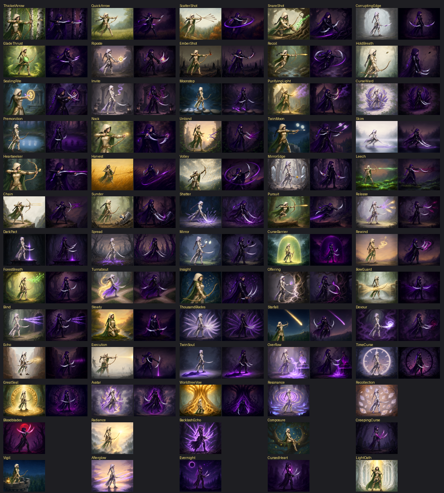
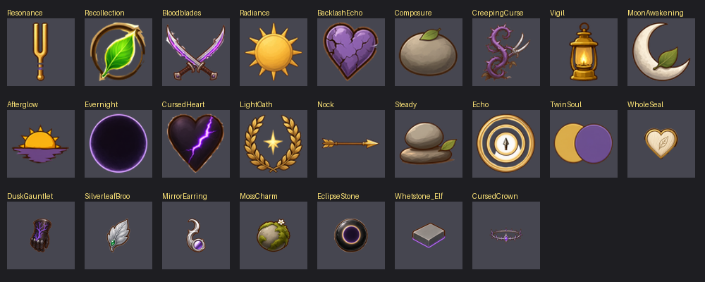

# 精灵 · 被诅咒的游侠（Slay the Spire 角色模组）

> A Slay the Spire (StS 1) character mod: a light elf ranger whose cursed other half fights with twin blades.
> Every card has a **light face** and a **cursed face**. Chinese and English text.


> **状态：原型。** 代码可以编译、补丁能注入游戏、内容齐全，但**还没有在游戏里实际玩过**，数值也没有平衡过。

## 玩法一句话

铁甲战士烧掉自己的东西换力量；她**放出诅咒，让同一张牌用两次**，再在反噬之前把它封回去。

| 规则 | 说明 |
|---|---|
| 两面 | 攻击牌和技能牌都有光面（弓 · 守护）和蚀面（双刃 · 诅咒），开局全是光面 |
| 侵蚀 | 把另一张光面手牌翻成蚀面。蚀面数值更高、多段，费用至少为 1 |
| 自动封印 | 蚀面打出后自己翻回光面，**回到手牌**，等于同一张牌打两次 |
| 咒鸣 | 本回合每翻一次面 +1。蚀面每段伤害 + 咒鸣，光面伤害 / 格挡 + 咒鸣，回合内越翻越疼 |
| 反噬 | 回合结束时，手里每张蚀面让你失去 2 生命 |

三种形态只做表现：手里没有蚀面时是精灵，手里有蚀面时变成半诅咒的中间态，打出蚀面攻击时是暗精灵双刃斩。

完整规则、胜利逻辑、四要素（费用 / 过牌 / 伤害 / 防御）分析和全部卡牌数值见 [设计稿 v4](docs/cards-relics-design.md)。

## 内容

- **角色**：70 生命，3 能量，起始牌组 打击 ×4、防御 ×4、咒之低语、单刃斩，起始遗物 裂纹封印
- **卡牌 72 张**：起始 4 + 普通 20 + 罕见 32 + 稀有 16，其中能力牌 13 张，其余都是双面卡
- **能力 19 个、遗物 10 件**（含 Boss 遗物 完整封印 / 诅咒王冠）
- **动画**：精灵 7 个动作（待机、攻击、施法、格挡、受击、死亡、胜利）+ 中间态待机 + 暗精灵双刃攻击，逐帧 PNG
- **文本**：简体中文、英文





## 安装与运行

需要正版《杀戮尖塔》、[ModTheSpire](https://github.com/kiooeht/ModTheSpire) 和 [BaseMod](https://github.com/daviscook477/BaseMod)（创意工坊订阅即可）。

1. 构建（见下）或下载 Releases 里的 `ElfPrototypeMod.jar`，放进游戏目录的 `mods\`。
2. Steam 里用 “Play With Mods” 启动，在 ModTheSpire 启动器勾选 **BaseMod** 和 **Elf Prototype**。
3. 选人界面选 **精灵**。

也可以用脚本部署和启动（Windows PowerShell）：

```bash
powershell -ExecutionPolicy Bypass -File deploy.ps1
```

```bash
powershell -ExecutionPolicy Bypass -File run-mts.ps1
```

`deploy.ps1 -Remove` 可以把模组从 `mods\` 移除。

## 构建

需要 JDK 9 及以上（以 `--release 8` 编译，游戏自带 Java 8）和 Maven。游戏本体、ModTheSpire、BaseMod 只作为编译依赖，**不会**打进 JAR，也不在本仓库里。

1. 复制本机路径配置并按实际位置修改：

   ```bash
   copy .mvn\maven.config.example .mvn\maven.config
   ```

   - `sts.home`：含 `desktop-1.0.jar` 的游戏目录
   - `sts.workshop`：创意工坊目录 `.../workshop/content/646570`（ModTheSpire 在 `1605060445`，BaseMod 在 `1605833019`）
   - 示例里的 `-gs .mvn/global-settings.xml` 让 Maven 使用工程内的空全局设置；如果你的 Maven 设置正常，可以删掉这两行。

2. 在工程根目录编译：

   ```bash
   mvn package
   ```

   产物在 `target\ElfPrototypeMod.jar`。编译时会跑 26 项单元测试：动画播放逻辑，以及 72 张牌、19 个能力、10 件遗物的文本和图片是否齐全。

## 调试命令

游戏里按 `` ` `` 打开 BaseMod 控制台：

| 命令 | 作用 |
|---|---|
| `hand add elfprototype:<卡牌ID>` | 把某张精灵卡加入手牌（BaseMod 自带命令） |
| `relic add elfprototype:<遗物ID>` | 获得某件遗物 |
| `elf status` | 当前动作、帧号、手里是否有蚀面 |
| `elf play <动作>` | 预览一个动作（如 `attack_cursed`、`idle_cursed`） |
| `elf debug` | 显示动作名、帧号、画布框和脚底锚点 |

模组还保留了早期的“测试外观”：可以把精灵动画套在一个原版角色上（默认铁甲战士），用 `elf on` / `elf off` 开关。详见 [开发笔记](docs/dev-notes.md)。

## 目录

| 路径 | 内容 |
|---|---|
| `src/main/java/elfprototype/character` | 角色、枚举 |
| `src/main/java/elfprototype/cards` | 双面卡基类 `DualFaceCard`、全部卡牌、注册清单 `ElfCards` |
| `src/main/java/elfprototype/mechanics` | 核心规则 `Lumen`（侵蚀 / 封印 / 咒鸣 / 反噬）、咒鸣能力、通用动作 |
| `src/main/java/elfprototype/powers` / `relics` | 能力、遗物 |
| `src/main/java/elfprototype/skin` / `anim` | 逐帧 PNG 动画播放与绘制 |
| `src/main/resources/elfprototype` | 图片、动画帧、中英文本 |
| `docs/` | 设计稿、美术计划、出图提示词、开发笔记 |
| `tools/` | 文本生成（`build_strings.py`）、美术导入与出图流程脚本 |
| `TEST-RECORD.md` | 每一轮的实现、构建与验证记录，以及游戏内验证清单 |

改卡牌文字时编辑 `tools/build_strings.py`，再运行：

```bash
python tools/build_strings.py
```

## 许可

- **代码**（`src/main/java`、`src/test`、`tools/`、构建与部署脚本）：[MIT](LICENSE)。
- **美术与文本内容**（`src/main/resources/elfprototype/` 下的图片、动画帧和角色 / 卡牌文本，以及 `docs/images/`）：**保留所有权利**，未经许可不得使用，详见 [ASSETS-LICENSE.md](ASSETS-LICENSE.md)。

本项目是爱好者制作的模组，与 Mega Crit 无关。Slay the Spire 是 Mega Crit 的商标；本仓库不包含任何游戏本体文件。
